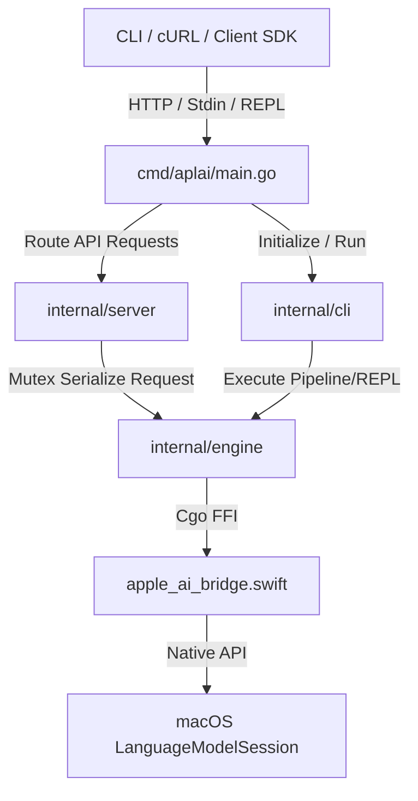

# APLAI Architecture Specification

This document provides a detailed breakdown of the system architecture, component design, Cgo memory safety boundaries, and concurrency execution model of APLAI.

---

## 1. System Overview

APLAI is divided into two primary runtime layers: the **Go CLI & Web Core** and the **Swift Apple AI Bridge**. 

The boundary between Go and Swift is spanned via a standard Cgo layer. Because Go and Swift have independent runtimes (garbage collection vs. Automatic Reference Counting), the Cgo boundary is carefully decoupled using scalar identifiers rather than pointer sharing.



---

## 2. Package Architecture

### 2.1 Component Modules

*   `cmd/aplai/main.go`: The central application orchestrator. Parses command-line flags, loads configuration file fallbacks, initializes the custom logger, and routes to the REPL chat, HTTP server, or standard pipeline mode.
*   `internal/config`: Loads YAML files and enforces fallback priority order (explicit flag ➔ current working directory ➔ executable directory ➔ default values).
*   `internal/logger`: Implements a structured logger writing JSON events to a size-rotating file rotator and human-readable text to stderr. Preserves the original file/line caller location when wrapped by parsing dynamic runtime stack frames and passing unadjusted Program Counters (PC) to `slog.Record`.
*   `internal/engine`: Manages Cgo bridging, memory allocations, and session mappings.
*   `internal/cli`: Exposes standard pipeline execution (`RunPipeline`) and interactive color-coded console loops (`RunRepl`).
*   `internal/server`: Exposes the OpenAI-compatible HTTP server (`/v1/chat/completions`) with Server-Sent Events (SSE) token streaming.

---

## 3. The Swift-Cgo Bridge & Memory Boundaries

### 3.1 Cgo Pointer Rules (Callbacks)
Go’s garbage collector (GC) prohibits passing Go-allocated pointers containing other Go pointers to C code. To support token streaming callbacks securely:
1.  **Registry Mapping:** Every active streaming request is registered in a thread-safe global Go registry (`sync.Map`) and assigned a unique integer `streamID`.
2.  **Scalar Casting:** The `streamID` is cast to `unsafe.Pointer(uintptr(streamID))` and sent to C/Swift as the `userData` pointer. Because this pointer represents a scalar integer and does not point to Go-managed memory, it satisfies Cgo pointer-passing safety invariants.
3.  **Callback Dispatch:** When Swift generates a token, it calls the exported Go gateway function `goTokenCallback(cStr, userData)`. The gateway casts `userData` back to the integer `streamID`, retrieves the active closure from the registry, and fires the token callback.

### 3.2 Swift Async/Sync Coexistence
The macOS `LanguageModelSession` is entirely asynchronous (`async/await` Swift concurrency). To call it synchronously from Go’s blocked Cgo OS thread:
-  The C-callable bridge blocks the caller thread using a Swift `DispatchSemaphore(value: 0)`.
-  It runs the `LanguageModelSession` response generation inside an unstructured Swift `Task`.
-  When the session finishes responding, the `Task` signals the semaphore, releasing the blocked Go thread.

### 3.3 Memory Allocation Lifecycle
To prevent memory leaks across the Cgo boundary:
-  Swift copies strings allocated in Swift memory into C-managed memory using `strdup`.
-  The Go wrapper copies the C string into Go memory using `C.GoString` and immediately schedules deallocation of the C pointer by calling the exported bridge function `FreeAppleAIString(cStr)`.

---

## 4. Concurrency Queueing & Serialization

The macOS `LanguageModelSession` runs in-process and is designed for single-thread execution. Multiple concurrent inference requests can lead to graph recompilation conflicts and hardware/memory overload.

To ensure safety:
-  The `server.Server` struct contains an execution Mutex (`sync.Mutex`).
-  All requests routed to `/v1/chat/completions` must acquire this mutex before initializing a new `LanguageModelSession` or running inference.
-  This serializes model execution, queuing concurrent client arrivals and guaranteeing that only a single model session runs on the Apple Silicon hardware at any given moment.

---

## 5. Directory Layout

```
/
├── cmd/
│   └── aplai/
│       └── main.go           # CLI Entrypoint
├── internal/
│   ├── cli/
│   │   ├── chat.go           # Interactive REPL chat
│   │   ├── chat_test.go
│   │   ├── pipeline.go       # Stdin piping/pipeline execution
│   │   └── pipeline_test.go
│   ├── config/
│   │   ├── config.go         # YAML loader and fallbacks
│   │   └── config_test.go
│   ├── engine/
│   │   ├── bridge.go         # Cgo bindings
│   │   └── bridge_test.go
│   ├── logger/
│   │   ├── logger.go         # Custom structured slog wrapper
│   │   ├── logger_test.go
│   │   ├── rotator.go        # Thread-safe log file rotator
│   │   └── rotator_test.go
│   └── server/
│       ├── server.go         # OpenAI HTTP completions server
│       └── server_test.go
├── apple_ai_bridge.swift     # Swift-to-C bridge code
├── Makefile                  # Build automation
├── config.yaml.example       # Example configuration
└── README.md                 # Project README
```
